# VPN routing investigation — 18 October 2026

This report records the original observed installation. Later 3.2.0 source and packaging follow-ups, including IPv6 capture and the user's approved GUI-session-only protection, are recorded in [the release verification ledger](RELEASE_SYNC_3_2_0.md#gui-session-lifetime-correction). Controlled live crash/dual-stack acceptance of that new candidate remains pending; the original observations below are retained as historical evidence.

The reported mismatch was reproduced: the checker's main HTTPS result used the local ISP address (`HOME_A`), while WebRTC used the Netherlands VPN address (`VPN_A`). Independent HTTPS and both configured STUN probes also returned `VPN_A`. The checker is currently explicitly configured DIRECT, and its destination additionally belongs to a DIRECT Russian IP range. This is consistent with the observed split, rather than evidence that WebRTC is leaking the home address.

A separate code defect explains why moving a domain to the VPN list was insufficient: General mode discarded that list except for exact overrides of default private CIDRs, and the core checked excluded IP ranges before names. Another confirmed defect dropped 12 domain-zone wildcards from the selected GeoSite data. Source changes and isolated regression checks are prepared. **The installed application, saved policy, active connection, firewall and system routes have not been replaced or reconfigured. No post-fix device-wide routing result is claimed.**

All observation times below use Asia/Yekaterinburg (UTC+05:00). Source public addresses and the personal DoH device URL are omitted. The structured, redacted evidence is in [vpn-routing-2026-10-18.json](evidence/vpn-routing-2026-10-18.json).

## Running application and source provenance

| Item | Observation |
| --- | --- |
| Windows | 24H2, kernel build 10.0.26100.8457, x64; the legacy registry ProductName still says Windows 10 Pro |
| GUI | `trusttunnel.exe`, version 3.1.0, PID 34496, started 17 Oct 13:24:46 |
| Core | `trusttunnel_client.exe`, actual `--version` output 1.1.7, PID 49924, child of PID 34496, started 18 Oct 03:50:09 |
| Executable directory | `%ProgramFiles%\TrustTunnel Client Pro`; both PE headers report machine 0x8664 |
| Persistent data directory | `%LOCALAPPDATA%\TrustTunnel Client Pro`, including the folder supplied by the user |
| Actual core arguments | `-c <data directory>\TrustTunnel_nl-hip-hosting.toml -l info`; read from the running process |
| Active profile | NL Hip-Hosting; `configs.json` marks it last-used; its configuration path matches the actual command line |
| Capture | WinTUN, interface index 20; IPv4 included route `0.0.0.0/0`, empty explicit excluded-routes array; observed split public routes point at TUN |
| VPN transport | HTTP/3 to the configured VPN endpoint; this transport is distinct from user STUN/HTTPS connections |
| Protection | Kill Switch enabled in the current profile; one other saved failover profile has it disabled; automatic failover is enabled |
| Other VPN software | AmneziaVPN service exists, but no second active VPN adapter was identified; its presence alone does not establish interference |

The GUI and core image paths were obtained with normal limited-information process queries; a subsequent command-line query confirmed the actual config argument. They match the Program Files PID marker and the startup logs. No second TrustTunnel GUI/core pair or TrustTunnel service was found. The initially unavailable WMI command-line fields were not treated as proof that a process was absent.

The initial project HEAD was `d6d239afb25646240230f72ec2778f6e9b1453f2`, with a clean worktree. Its functional Pro/core source directories match the published Pro 3.1.0 release source `19179709045dc2fa533eac388563fc3e830328ab`. GUI metadata is 3.1.0; the core is the fork's upstream-1.1.7 generation with Windows changes. Version agreement and this source comparison are established; an exact reproducible binary-to-source build identity is not. September executable timestamps alone do not indicate an old installation: the installer preserves build timestamps.

Installed SHA-256 values:

- GUI: `10c1b7a196370889e86ad9e6e41bc16addc72e751cfc1bda98dcc5a5c8381aad`.
- Core: `4fc5b18c9a0ccbf4bd0bab27396d4ebfd55c201b05e11d4755bb11ef94bd42c9`.

The matching [official 1.1.7 configuration reference](https://raw.githubusercontent.com/TrustTunnel/TrustTunnelClient/170609c24ca865819fed68437b01c013049bc3fa/trusttunnel/README.md) documents General/Selective mode, DNS routing settings, default-disabled early name inspection and wildcard syntax. Process files and the new policy format are fork extensions, not claimed to be upstream 1.1.7 features.

## Settings to connection chain

```mermaid
flowchart LR
    UI[Routing interface] --> JSON[routing_rules.json]
    JSON --> RES[Resolve GeoIP, GeoSite and cached groups]
    RES --> FILES[resolved lists and profile TOML]
    FILES --> SPAWN[Core launched with actual -c path]
    SPAWN --> MEMORY[Rules read into core memory]
    MEMORY --> PROCESS[Forced process action]
    PROCESS --> FILTER[Address and domain policy]
    FILTER --> EXIT[VPN endpoint or DIRECT]
```

Relevant paths are [useRoutingState.ts](../gui-pro/src/components/routing/useRoutingState.ts), [routing_rules.rs](../gui-pro/src-tauri/src/routing_rules.rs), [sidecar.rs](../gui-pro/src-tauri/src/sidecar.rs), [config.cpp](../trusttunnel/src/config.cpp), [client.cpp](../trusttunnel/src/client.cpp), and [tunnel.cpp](../core/src/tunnel.cpp).

At 03:50:09 the running core logged reading the exact `resolved/exclusions.txt` path referenced by the active TOML, with 633,761 bytes, and `process_direct.txt`, with 110 bytes / seven processes. The on-disk list contains 30,863 lines. Config/list modification times align with that startup; a different runtime configuration directory was not used in this session.

The core reads these files at startup. Writing new files is not a hot reload of the current core's memory. The ordinary Routing Save button requests a reconnect; inactive autosave only persists the policy. Background data/file updates and saving without reconnect must therefore be distinguished from a new loaded generation. Existing browser connections and DNS/name caches also survive ordinary page reloads, so the independent socket probes used fresh connections without switching the server.

## Actual policy and priority

The Russian policy is a combination of `geoip:ru`, `geoip:private`, `geoip:yandex`, GeoSite categories, the cached `ru_whitelist` group, and manual domains. It is not simply a geographical interpretation of every website. The saved rules include 20 DIRECT entries, three VPN entries and seven DIRECT executable names.

The selected databases contain 25,194 Russian CIDRs, 18 private CIDRs and 50 Yandex CIDRs, including both address families. Selected GeoSite entries use supported suffix/full domain types; no selected Plain/Regex entries were found. Other databases/categories can contain unsupported Plain/Regex patterns, which the current importer drops rather than interpreting as regex rules.

Installed GeoIP and GeoSite payload hashes match the latest [publisher release payloads](https://github.com/runetfreedom/russia-v2ray-rules-dat/releases/tag/202610172319), checked during the investigation. The local metadata tag is older (`202610170758`), but the payload contents are identical. Stale database contents do not explain the demonstrated checker conflict. The `ru_whitelist` cache is a separate snapshot dated 17 Oct 06:50: all five configured public sources were fetched successfully, and their current union exactly matches its 1,612 names. Those sources are the hxehex mobile-internet whitelist and the RockBlack-VPN Ozon, Rutube, VK and Wildberries lists; no active cache was rewritten.

The installed priority is:

1. A forced process action, when the owner is identified.
2. Address/port/CIDR exclusion.
3. A cached domain for that address and application.
4. Name extraction from eligible TLS/QUIC traffic when the earlier decision permits it.
5. The mode's default route: VPN in General, DIRECT in Selective.

This is a set-based matcher, not a first-row-wins ordered rule list. Changing the visual order does not make the VPN list override a Russian CIDR. A bare GUI domain expands to apex plus wildcard; the core's bare name itself only covers that host and its `www` counterpart. Unicode domains are converted to ASCII IDN form by the GUI; the prepared core also normalizes ASCII case. Browser DoH, ECH, shared IPs and expired/absent name associations can still limit domain attribution.

The user clarified that **process rules outrank site rules**. The prepared implementation preserves this. Explicit user domains then outrank broad lists in both directions; more specific overlapping user domains win. At the same specificity, the mode's explicit default override wins. Explicit address rules are evaluated before group address rules; a known explicit domain is evaluated before address groups. These choices are documented because the text order is not the policy.

## Confirmed defects and prepared changes

### R1 — VPN exceptions disappear in General mode

**Before:** `build_general_exclusions` started with the complete DIRECT list. It used VPN entries only to suppress an exactly equal default private CIDR. It did not remove or override `geoip:ru`, a DIRECT domain group, or a broader CIDR. The core's `match_tag` checked addresses before names. For the checker, `81.26.177.53` matches DIRECT `81.26.176.0/20`; moving only the manual domain cannot cancel this range.

**Change:** [routing_policy.rs](../gui-pro/src-tauri/src/routing_policy.rs) preserves both directions, with explicit entries separated from group entries. [domain_filter.cpp](../core/src/domain_filter.cpp) and [domain_filter.h](../core/include/vpn/internal/domain_filter.h) implement those priorities. [tunnel.cpp](../core/src/tunnel.cpp) and [dns_handler.cpp](../core/src/dns_handler.cpp) use the same decisions for destination selection, name inspection and DNS. Unknown potentially protected names conservatively prefer VPN when inspection cannot establish the target, rather than trusting a broad DIRECT IP match.

The fork's generated policy v1 uses `!entry` for a group default override, `+entry` for an explicit exclusion, and `^entry` for an explicit default. This restores VPN in General and DIRECT in Selective; users do not need to type these markers. The compiler also retains default private-network bypasses. An actual rule for a site's name remains different from a rule for an arbitrary unidentifiable UDP address.

The GUI checks that the sidecar advertises policy-v1 support before launching a profile that requires it. An old core must not silently ignore the new markers. **The matching GUI and rebuilt core must be distributed together.**

### R2 — GeoSite zone suffixes lose their wildcard scope

**Evidence:** Independent expansion of the installed selected data and canonical comparison with the actual resolved file found exactly 12 missing wildcard entries: `.moscow`, `.ru`, `.su`, `.tatar`, seven additional punycode zones including `.рф`, and `.yandex`. The complete list is in the evidence JSON. No other semantic difference remained after normalizing CIDR representation.

**Cause:** [geodata_v2ray.rs](../gui-pro/src-tauri/src/geodata_v2ray.rs) passed a typed GeoSite Domain suffix through the hand-entered-domain guard. That guard deliberately does not expand dotless input. Thus `ru` reached the core as the literal host `ru`, not every site ending in `.ru`. GeoIP and separate domain rules could conceal the missing zone coverage.

**Change:** GeoSite suffix metadata now retains apex/wildcard scope for a single DNS label and converts an internationalized zone to IDN ASCII. Hand-entered dotless input keeps its existing semantics. The new Rust regression failed before the change; the same fixture is exercised by the native C++ matcher.

### R3 — Preparation failures can start stale or incomplete rules

**Before:** connect, tray connect and supervised reconnect logged resolver/write errors and continued to spawn. Missing referenced groups were collected as warnings but preparation still succeeded. Atomic writes protected each file individually, but did not make a failed multi-file policy generation valid.

**Change:** [routing_rules.rs](../gui-pro/src-tauri/src/routing_rules.rs) refuses an unresolved referenced list before writing a new policy. [commands/vpn.rs](../gui-pro/src-tauri/src/commands/vpn.rs) and [tray.rs](../gui-pro/src-tauri/src/tray.rs) stop after required preparation fails. The reconnect cause is preserved and marked terminal by [lifecycle.rs](../gui-pro/src-tauri/src/lifecycle.rs) and [connectivity.rs](../gui-pro/src-tauri/src/connectivity.rs). The interface explains in Russian/English that the connection was cancelled rather than starting old settings.

This is a required-precondition fix, not a new transaction format for all files. An already running core continues to hold its previous in-memory rules; a failed save does not assert that they changed.

### R4 — Missing external routing files become empty policy

**Before:** [config.cpp](../trusttunnel/src/config.cpp) ignored file-open failures and unchecked short reads. A missing protected list could consequently become an empty list; in Selective mode that selects DIRECT by default. Missing process files likewise lost their intended action.

**Change:** a configured rule file must be completely readable, or configuration loading fails before TUN/network setup. Reading is binary, so Windows newline conversion cannot cause artificial short reads. An intentionally empty, successfully read file remains valid. A regression checks all four configured list types and an empty valid file.

### R5 — The final-route diagnostic printed the source as destination

**Before:** the CLI callback built its destination text with the source address again. The preliminary-action log in `client.cpp` also used an obsolete label array: actual forced DIRECT was printed as PROXY and forced VPN as BYPASS. A preliminary application action is not the final core route in any event.

**Change:** [client.cpp](../trusttunnel/src/client.cpp) prints the actual enum and labels it as a requested action. [trusttunnel_client.cpp](../trusttunnel/src/trusttunnel_client.cpp) logs the existing structured final-action event at debug level, with actual source/destination ports, protocol, engine-supplied domain association, action and time. A name association may come from the cache rather than this connection's visible TLS name. This permits correlation with an OS process/socket snapshot. It does not fabricate a matched UI rule ID or a process name absent from the native event. Ordinary info logs remain insufficient for a complete historical per-connection trace.

## Connection evidence and scenario table

`Measured` means an actual response or OS ownership snapshot. `Configured` means the rule is present but the exact engine rule-selection event was not logged. `Fixture` means isolated source testing, not an installed-client experiment.

| Scenario | Expected route | Actual route / result | Matching rule | Evidence |
| --- | --- | --- | --- | --- |
| Checker in the currently saved policy | DIRECT | `HOME_A`, local ISP, browser 09:17 | Manual DIRECT plus Russian `81.26.176.0/20`; exact selected event absent at info level | Browser main-IP result; actual config/list; core and Vivaldi network-process TCP sockets to destination |
| Checker explicitly moved to VPN while retaining Russian bypasses | VPN | Old generator/matcher cannot guarantee VPN; prepared fixture selects VPN | Explicit user exception above broad CIDR | Five original native regressions failed before; shared Rust/compiler-to-C++ fixture passes after; live installed rules were not edited |
| Unlisted foreign HTTPS destination `api.ipify.org` | VPN | `VPN_A`, HTTP 200, fresh Python connection 09:21 | General default; no matched DIRECT entry | Server-reported source address, independently compared with browser WebRTC |
| Cloudflare STUN, UDP/IPv4 port 3478 | VPN | `VPN_A` | General default; no matching DIRECT domain/IP | STUN binding reply, PID/local port/destination/time recorded |
| Google STUN, UDP/IPv4 port 19302 | VPN | `VPN_A` | General default; no matching DIRECT domain/IP | Independent STUN binding reply |
| Checker one-time DNS names | Resolver and DNS transport must be evaluated separately | Browser reports Netherlands recursive DNS; exact DNS transport route not captured | `*.ip.platipomiru.com` is DIRECT if the core sees the DNS name | Browser DNS result; DNS-handler source; no claim that resolver location proves transport egress |
| `ya.ru` | DIRECT | Fresh TLS socket forwarded by core over physical Ethernet at 09:36; separate HTTP probe returned 302 | Russian CIDRs plus Yandex/category/whitelist domain entries | Actual Python/core socket ownership snapshot; configured rules |
| `www.avito.ru` | DIRECT | Fresh TLS forwarded over physical Ethernet at 09:36; separate 09:21 GET returned 429 with limited-access text | `176.114.112.0/20`, Avito/category/whitelist entries | OS snapshot plus separate public HTTP response; no causal attribution of 429 to routing |
| `esia.gosuslugi.ru` | DIRECT | Fresh TLS forwarded over physical Ethernet at 09:36; separate GET returned 200 | `213.59.192.0/18`, government/category/manual domain entries | OS snapshot and HTTP response; account login was not attempted |
| Explicit DIRECT site inside a broad VPN group | DIRECT | Prepared native fixture selects DIRECT | Explicit site above group | Shared Rust-generated fixture and native tests; installed state unchanged |
| A `.ru`/`.рф` site outside all other DIRECT entries | DIRECT under the selected suffix data | Original zone wildcard absent; prepared suffix fixture matches | GeoSite Domain suffix | Installed-list comparison, failing Rust test before, native/Rust fixture after |
| Listed game/music executable | DIRECT, ahead of site rules | Source selects forced bypass if ownership lookup succeeds; no live selected process was available | `process_direct.txt`, exclude mode | Seven loaded entries; core process-action code; no invented live result |
| Unlisted process | General site/IP policy | Python probes demonstrate VPN for foreign and DIRECT for sampled Russian destinations | Mode default or matching exception | Fresh sockets from an unlisted process |
| Full VPN control with routing rules removed | VPN for checker and STUN | User reported agreement; not rerun during this session | No exclusions | User observation only; changing the active policy was deferred |

The TCP snapshot is evidence that the **core itself opened a separate connection to the final site over physical Ethernet**. A browser's Remote Address alone was never used as the public-source-IP measurement. For the checker/foreign HTTPS/STUN, public source evidence comes from the server/STUN responses. No per-UI-entry rule ID is available in the current native logs, so the table does not invent one.

## DNS, browser, IPv6, processes and remaining limits

- TUN DNS addresses are `46.243.231.30/31`; the physical interface uses a private router. The active profile specifies custom endpoint DoH. The personal path is redacted. No FakeIP mechanism was found. The core uses DNS-derived suspects, a bounded per-application name cache and TLS/QUIC extraction. Domain-to-IP attribution is still limited by external encrypted DNS, ECH and shared-IP cache ambiguity.
- The browser is Vivaldi, exposed through the Chrome connector. Its actual network service process was PID 38124, distinct from main PID 22148. No explicit DoH/proxy policy or standard preference override was found; this does not prove secure DNS is inactive.
- Windows has automatic PAC and autodetection enabled even though fixed ProxyEnable is zero. The configured PAC URL returned HTTP 403 to an independent fetch. Effective browser PAC use/fallback was not established, and these settings were not changed. A PAC/proxy connection can hide a final site's identity from TUN policy, so this remains a separate potential influence.
- The active uplink has only link-local IPv6, and TUN has private/link-local IPv6. No usable global IPv6/default route was found. The demonstrated mismatch is IPv4. Existing IPv4-only capture is a conditional coverage defect on a future IPv6-capable uplink; use proper per-family capture/blocking and approved DIRECT exceptions, rather than treating permanent IPv6 disabling as a diagnosis.
- Process rules match executable basenames, not full paths, PID trees or inherited launcher policy. Children require their own names. Ownership lookup currently consults IPv4 tables and the first matching local port, with a session PID/name cache. IPv6, port reuse/ambiguity, Unicode case and cached lookup failure remain limitations. `only` forces listed processes into VPN while unlisted ones still follow the global policy. The Russian/English description was corrected to explain this behavior rather than claiming an exclusive process whitelist.
- The current profile's Kill Switch rejects VPN-designated traffic when the live core loses its endpoint. A saved failover profile has Kill Switch disabled, which explicitly permits direct fallback. Separately, the Windows filtering barrier shares the core's dynamic WFP-session lifetime. Surviving a core crash/restart gap requires an independent persistent barrier that preserves approved split exceptions. These conditions were already described in [the security audit](../WINDOWS_VPN_SECURITY_AUDIT.md); they are not asserted to have caused this live mismatch and were not induced on the user's connection.
- No QUIC packet capture, dual-stack sink experiment, deliberate tunnel outage, core kill, server switch or authenticated Yandex/Avito/Gosuslugi failure trace was performed. HTTP/3 VPN transport is not proof that a browser's own request used QUIC. Browser login failures require the actual failed URL/status/time and simultaneous route evidence; a CAPTCHA/429 alone does not supply that cause.

The checker script was fetched again. SHA-256 is `075f8e7a2a493c7efae0956ff144c979a3766b81a7dc82bc2a36d18b1acc6df3`. It confirms `/api/check` → `info.ip`, `/api/verdict`, `webrtc_ips`, `webrtc_done`, `dns_token`, both named STUN services, three one-time DNS probes and the `/api/challenge`/`X-Captcha` flow. An independent unauthenticated `/api/check` returned 403 requiring CAPTCHA; this was treated as API protection, not routing failure. Browser navigation completed the site's normal built-in flow; no challenge bypass was implemented.

## Validation and application plan

Final check results and limits are recorded in the evidence JSON. The initial five matcher regressions failed against the pre-change implementation; configured-file failure and GeoSite suffix regressions also reproduced before their changes.

| Validation | Result |
| --- | --- |
| Frontend suite | 254 files, 4,090 tests passed |
| Frontend type checking, linting, translation keys, production build | Passed |
| Actual Rust routing-file suite | 30 passed, using the project's isolated test data roots |
| Actual Rust policy compiler | 7 passed |
| Actual Rust domain/IDN scope tests | 10 passed |
| GeoSite zone-suffix regression | Failed before; passed after |
| Reconnect terminal-cause regression | Passed |
| `cargo check --locked --all-targets` | Passed |
| Native C++ matcher | Initially 5 failures in 58 tests; final 67 tests passed, including new fixtures |
| Native C++ configured-file loader | Failed before; final 2 tests passed |
| Six changed production C++ translation units | Compile checks passed against available cached dependency headers/archives |
| Full clean native core build, installer packaging, VM/network fault tests | Not performed |

The native matcher/config-loader checks compile the actual changed production units in isolation. They do not substitute for rebuilding and integrating the entire native core with the exact release dependency set. No installed EXE was executed as a replacement. Portable build tools/dependency caches and a genuine stock sidecar copied as a worktree build resource do not modify the installed application. A frontend build is not a VPN installer or a device-wide routing test.

Apply as a separate reviewed stage:

1. Finish a clean matching native core/GUI build and packaging checks. Keep the policy-v1 compatibility check. The stock binary copied only as a build resource in this worktree must not be shipped as the patched engine.
2. In an isolated Windows test environment, verify General split mode with fresh TCP, UDP/STUN and QUIC connections, both address families, explicit site overrides in both directions and forced process rules. Use a controlled source-IP sink and capture the actual final route, not only destination addresses. Test required-list failures and unavailable endpoints separately.
3. Before changing the installation, make a local backup of both executable files and the complete application data directory, including all saved profiles and rules. Keep secrets local. Record hashes and the active server; arrange a short reconnect window.
4. Install the matching pair. Change the checker to VPN through the interface while retaining Russian DIRECT rules. Enable Kill Switch for every profile eligible for automatic failover. Reconnect to the same server, then use fresh browser connections. Recheck checker HTTPS, both STUN destinations and DNS as separate observations.
5. For strict protection during core death, implement/test a persistent Windows barrier outside the tunnel process, allowing only approved DIRECT exceptions and necessary VPN bootstrap. Cover IPv6 explicitly. These require their own validation and are not silently declared fixed by the routing patch.
6. Roll back by exiting the new application, restoring the paired original binaries and the backed-up data directory, then starting the original profile. Restore binaries and generated policy together, because policy-v1 markers are unsupported by the original engine. Verify adapter/DNS state and the previously recorded split behavior.

The next live observation needed for a remaining site symptom is one failed browser request captured with URL, timestamp, owner process, address family/protocol, response/status and the core's final route. The active profile/server must stay fixed while comparing fresh connections. The prepared debug event improves this trace, but cannot retrospectively reconstruct missing info-level records.
